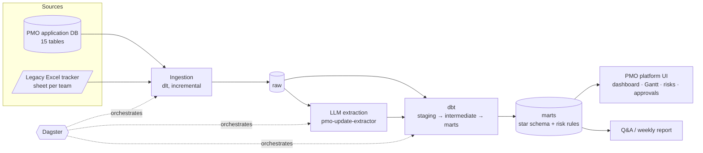

# PMO Portfolio Platform

A project management platform for the PMO of a global after-sales organisation, with a full data pipeline behind it, built on **fully fictional data**. It covers the whole project lifecycle (request, approval, milestones with evidence, changes, bi-weekly updates, close review, strategic board votes, reminders) and turns that operational data into a tested warehouse, AI-read status updates and PMO dashboards.

> **All data is synthetic.** Elvanor is a made-up new energy vehicle (NEV) brand: battery-electric, plug-in hybrid and fuel-cell cars, buses and vans. Teams, people, projects and status updates are generated by the simulator in this repo from a random seed. Any resemblance of generated names to real people or companies is coincidental.

## The setting

Elvanor's international after-sales organisation runs hundreds of projects at once across **Europe, the Americas, the Middle East and Africa**: service network expansion, technician HV certification, parts warehouses, warranty processes, bus fleet maintenance contracts. A small PMO has to keep track of all of them.

| | Teams |
|---|---|
| Front office: regional after-sales teams (front-office meeting) | UK & Ireland · DACH · Benelux · Nordics · France · Iberia · Italy · Central & Eastern Europe · Mexico & Central America · Brazil · Southern Cone & Andes · GCC · Türkiye & Levant · North Africa · Sub-Saharan Africa |
| Middle office: HQ after-sales functions (middle-office meeting) | Customer Experience · Service Academy · Service Products & Pricing · Owner Engagement · Bus & Fleet Service · Technical Support & Warranty · Parts Supply · Service Network & Standards |

## How the PMO works (what the simulator reproduces)

- **Requests and approval.** Teams request new projects; the PMO approves, returns for rework (resubmitted as a new version) or rejects. The PMO can also set projects up directly.
- **Strategic projects.** S / A / B level projects go to a review board, and every voting member has to agree. A single "no" sends it back for revision and a new voting round.
- **Milestones with evidence.** Each milestone says what evidence is expected (text, screenshot, email, file). The owner submits, the PMO accepts or returns it.
- **Changes.** Extensions, new owners and extra executors go through change requests. Extensions are counted and the original end date is kept.
- **Bi-weekly project meetings, split by function.** The front-office meeting (regional teams) and the middle-office meeting (HQ functions) alternate weekly, so each team posts an update every two weeks for its own meeting.
- **Closing.** Close requests are pre-approved by the PMO, then the project waits (often for weeks) to be presented at its meeting, where it is closed or sent back.
- **Holds, cancellations, follow-ups.** Paused projects get reviewed and resumed, canceled or turned into follow-up items (incubation, post-close monitoring, routine monitoring).
- **People change.** Staff leave, managers are replaced, and projects of people who left wait for a new owner.
- **Reminder rules R1–R8** generate the system's emails: milestone heads-up, close-report heads-up, overdue notice, 7-day escalation, past-end notice, bi-weekly reminder, approval waiting, board vote reminder.

Distributions (durations, milestone counts, extension rates, outcomes) are calibrated so the portfolio looks like a real, busy after-sales PMO, not a toy dataset.

## Architecture (target)



See [docs/roadmap.md](docs/roadmap.md) for progress. **Done: stage 1 (source simulator), stage 2 (incremental ingestion into DuckDB) and stage 3 (dbt warehouse with tests).**

## Quick start

Requires [uv](https://docs.astral.sh/uv/). It installs the Python version pinned in `.python-version` (3.12) for this project automatically, whatever Python you have installed. Docker is optional.

```bash
uv sync

# Option A: no Docker, SQLite file at data/source.db
uv run python -m simulator init          # backfill 2024-07-01 → today (~3 s)
uv run python -m simulator advance --days 7
uv run python -m simulator status

# Load into the warehouse (data/warehouse.duckdb, schema "raw")
uv run python -m ingestion run           # first run: everything
uv run python -m simulator advance --days 7
uv run python -m ingestion run           # later runs: only what changed

# Build and test the warehouse (staging -> intermediate -> marts)
uv run dbt build --project-dir warehouse --profiles-dir warehouse

# Option B: Postgres in Docker (macOS / Linux, needs make)
make sim-init
make pipeline            # ingest + dbt build
```

Then query `data/warehouse.duckdb` with any DuckDB client, for example:

```sql
select team_code, category, risk_level, finding
from marts.mart_project_risks
where is_main_risk and risk_level = 'high';
```

A backfill produces roughly 400 projects, 1,000 requests, 50 board reviews, 850 milestones, 4,000 bi-weekly updates and 7,500 reminder emails across 23 teams. It also writes the legacy Excel tracker for the last 8 weeks and a ground-truth label for every status update.

## Source data

Details in [docs/source-data.md](docs/source-data.md). In short:

- **PMO application DB**: 15 tables (projects, milestones, evidence submissions, requests, board reviews and votes, meetings, updates, follow-ups, project event log, emails, people, team managers with validity dates). Every row has `updated_at` for incremental loads.
- **Legacy Excel tracker**: the workbook the PMO used before the system, still updated by teams in parallel: one sheet per team, with different layouts for front-office and middle-office sheets, old status vocabulary, legacy project codes, and about a fifth of rows weeks out of date. It has to be reconciled with the database.
- **Status updates**: free text written by people from many countries: bullets, numbered lists, prose and one-liners, abbreviations, typos, and dates like `w/c 10 Nov`, `14.11.2026` or `CW46`. The stated RAG is optimistic about a third of the time.
- **Labels**: the simulator knows the true RAG, risks, blockers and next milestone date behind every update, which makes LLM extraction measurable.

Example update:

```
Status: Amber
Done:
- 7 of 19 dealers onboarded
- meeting with HQ to align on scope
Issues:
- shipment stuck in customs in Morocco, may delay next step
Next:
- Pilot evaluated - target w/c 24 Nov
```

## Repository layout

```
simulator/
  company.py      teams, regions, project themes, milestones, risk categories
  calibration.py  rates and distributions (all tunable in one place)
  people.py       staff names by region, and the many ways a name gets typed
  textgen.py      bi-weekly updates + ground-truth labels
  engine.py       day-by-day workflow simulation with an agenda of delayed actions
  excel_export.py legacy tracker workbook
  schema.py       the 15 source tables
ingestion/
  app_db.py       dlt source: 15 tables, incremental on updated_at, merged on primary key
  tracker.py      dlt resource: weekly Excel tracker, header/layout detection
  __main__.py     `python -m ingestion run | status`
warehouse/        dbt project: staging -> intermediate -> marts (35 models, 131 tests)
  models/marts/core   star schema incl. SCD2 project history
  models/marts/pmo    risk findings, tracker reconciliation, team portfolio
tests/            simulator rules, full and incremental loads, tracker parsing
docs/             source data, ingestion, warehouse, roadmap
```

## Tests

```bash
uv run pytest -q
```

Besides determinism, the tests check that running the simulation in chunks produces exactly the same data as one long run, and that workflow rules hold: every closed project went through a pre-approved close request and a meeting, every strategic project had a unanimous board vote, every accepted milestone has accepted evidence, and updates belong to the team's own meeting (front or middle office). The ingestion tests check that a full load matches the source, a rerun without changes loads nothing, an incremental run loads exactly the changed rows, and both tracker layouts map to the same columns. The warehouse has 131 dbt tests, including singular tests that the rebuilt status history ends in each project's current status, that SCD2 versions are contiguous, and that every tracker row is reconciled exactly once.

## Related

- `pmo-update-extractor`: standalone tool for turning free-text project updates into structured status (in progress).

## License

MIT
