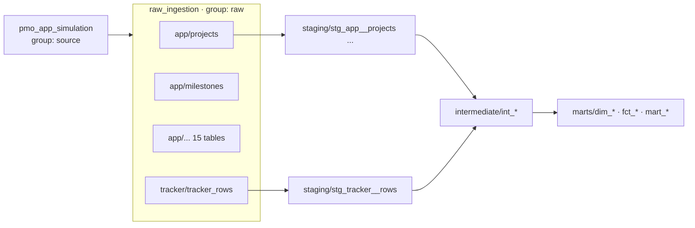

# Orchestration (stage 4)

`orchestration/` wires the three earlier stages into one [Dagster](https://docs.dagster.io) asset graph: simulate → load → transform → test, with a UI, two jobs and a weekly schedule.

```bash
uv run dagster dev        # UI on http://localhost:3000
```

In the UI: **Assets → View lineage** shows the whole graph; **Jobs** has the two pipelines; **Automation** has the schedule (off until you switch it on).

Without the UI:

```bash
uv run dagster job execute -m orchestration.definitions -j weekly_pipeline     # simulate a week + load + dbt build
uv run dagster job execute -m orchestration.definitions -j refresh_warehouse   # load + dbt build only
```

Set `DAGSTER_HOME` to a folder if you want run history to persist between sessions. Without it, `dagster dev` keeps history in a temporary folder.

## The asset graph



56 assets in 7 groups (`source`, `raw`, `ai`, `staging`, `intermediate`, `marts`, `reference`) and 148 asset checks.

| Asset(s) | What runs | Metadata shown in the UI |
|---|---|---|
| `pmo_app_simulation` | First run: backfill from 2024-07-01 to today. Later runs: advance `days` (config, default 7). | simulated-until date, rows written per table, tracker files written |
| `raw_ingestion` (16 assets `app/<table>`, `tracker/tracker_rows`) | The stage 2 dlt pipeline, one multi-asset. | rows loaded this run, per table |
| `extract/status_update_signals` (group `ai`) | Stage 5: reads new status updates with the rules (default) or an LLM (`EXTRACTOR=llm` in `.env`, at most `LLM_MAX_PER_RUN` per run). | extractor, updates extracted this run, still to do |
| `warehouse_dbt` (38 assets) | `dbt build` through dagster-dbt: every model and the seed is an asset. | dbt run results |

**Keys are chosen so the graph connects.** dagster-dbt keys a dbt source as `[source_name, table]`. The dbt project declares the raw tables as sources `app` and `tracker`, so the ingestion assets are keyed `app/<table>` and `tracker/tracker_rows`. Dagster then draws each staging model under the raw table it reads, without any manual wiring.

**Groups follow the dbt folders.** A small translator puts dbt assets in groups named after their folder (`staging`, `intermediate`, `marts`) and the seed in `reference`.

## One step at a time

The warehouse is a single DuckDB file, which allows one writing process at a time. The project therefore uses Dagster's in-process executor: steps run one after another in one process. A version that ran the row-count check and the extraction in parallel failed on DuckDB's file lock, which is what led to this choice. With a client-server warehouse the default multiprocess executor would run independent steps in parallel.

## Checks

- **Every dbt test is an asset check** on the model it tests (dagster-dbt does this automatically), so a failing test shows up red on the asset it belongs to.
- **`raw_matches_source`**: after each load, the row count of every raw table must equal its source table. It catches a broken incremental load straight away instead of three layers later.

## Jobs and schedule

| | Selection | When |
|---|---|---|
| `weekly_pipeline` | everything | schedule `weekly_pipeline_monday_morning`: Mondays 06:00 Europe/Amsterdam, before the PMO's weekly review (off by default) |
| `refresh_warehouse` | everything except the simulation | on demand. In a real deployment the source changes by itself, so this is the production job. |

## Configuration

One resource, `PmoSettings`, holds every path: the data folder (default `data/`, or `DATA_DIR`), the source database URL (default the SQLite file there, or `SOURCE_DB_URL`) and the simulator seed. The dbt asset passes the absolute warehouse path to dbt, because dagster-dbt runs dbt from inside `warehouse/`. The tests use the same resource to run the whole graph in a temporary folder.

## Rebuilt source → automatic full reload

When the simulator rebuilds the source from scratch (`simulator init`, or the first run of `pmo_app_simulation`), ids get reused and dlt's stored load positions no longer mean anything. Mixing the old and new raw rows would break the warehouse (the dbt relationship and uniqueness tests catch it). So `init` leaves a `.full_refresh_requested` marker in the data folder, and the next ingestion run does a full reload and removes the marker. This works the same from the CLI and from Dagster.

## Tests (`tests/test_orchestration.py`)

- the definitions load, the dbt source keys line up with the ingestion assets, and both jobs exist;
- the whole graph materialises in a temporary folder: the first run backfills, and every asset check passes;
- a second run with `days: 7` simulates exactly 7 days, loads nothing for unchanged tables and only the new status updates, and every check still passes.

CI also runs both jobs through the Dagster CLI.
