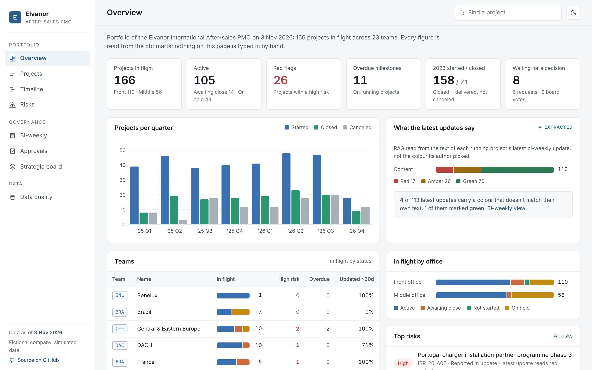
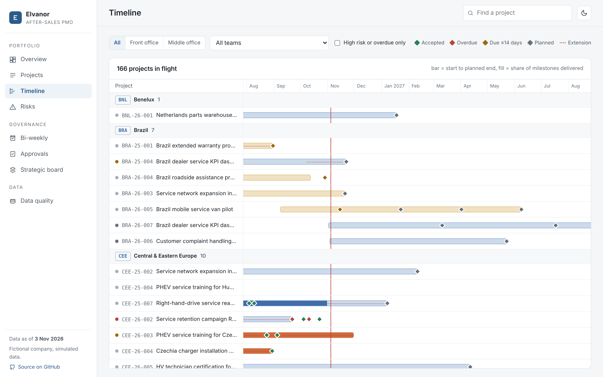
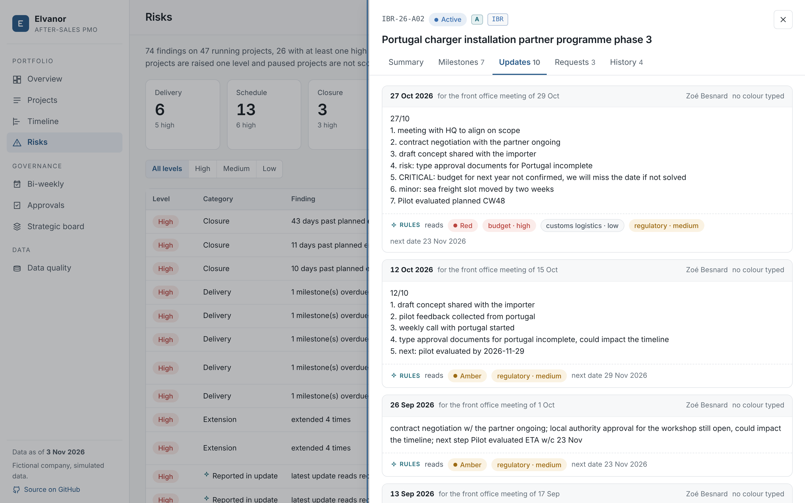

# PMO portal (stage 6)

`portal/` is the PMO's working view of the portfolio: eight pages and a project drawer, all read from the dbt marts.

```bash
uv run python -m portal serve      # http://localhost:8000, JSON API docs at /docs
uv run python -m portal export     # static copy in site/ (what GitHub Pages serves)
```

Build the warehouse first (README quick start, or one Dagster run).



## Pages

| Page | What the PMO sees | Reads |
|---|---|---|
| **Overview** | KPIs (in flight, red flags, overdue milestones, started / closed this year, decisions waiting), projects per quarter, what the latest updates say (RAG read from the text), teams, in flight by office, top risks | `fct_projects`, `mart_team_portfolio`, `mart_project_risks`, `fct_status_update_signals` |
| **Projects** | Every project with filters (status, office, team, strategic, text search): delivery, latest RAG, main risk | `dim_project`, `fct_projects` |
| **Timeline** | Gantt of projects in flight by team: bars from start to planned end filled by delivery, milestones coloured by state, extensions dotted, today line | `fct_milestones` |
| **Risks** | Findings by category and level, with what each rule means; paused projects listed for a PMO decision | `mart_project_risks` |
| **Bi-weekly** | Next front-office and middle-office meeting: who has posted, the colour typed versus the colour read from the text, blockers, on-time share at past meetings | `fct_status_updates`, `fct_status_update_signals` |
| **Approvals** | Requests waiting for a decision, monthly volume, return / rejection rates, median and P90 decision time, recent decisions | `fct_requests` |
| **Strategic board** | Strategic projects in flight, board review rounds with votes, board members | `fct_board_reviews`, `dim_person` |
| **Data quality** | Weekly Excel tracker versus the system: matches, status differences, rows missing on either side, how rows were matched | `mart_tracker_reconciliation` |

Clicking any project opens a drawer with its summary and open risks, milestones with evidence, every bi-weekly update with what the extractor read from it, its requests, and its version history from the SCD2 dimension.





## Design

- **One read model, two ways to serve it.** `portal/data.py` has one function per page that returns plain JSON. `portal/api.py` (FastAPI) serves them live at `api/<page>.json` and `api/projects/<id>.json`; `portal/export.py` writes the same responses to files. The front end fetches the same relative paths either way, so the live portal and the static demo can't drift apart. A test checks that an exported file equals the live response.
- **Read-only, and never in the pipeline's way.** DuckDB allows one writer. The API opens a read-only connection per request and closes it straight after, so a Dagster run can write between two page loads.
- **No build step.** The front end is one ES module (`static/app.js`) using Preact and htm, vendored in `static/vendor/` (about 13 KB). No Node, no bundler: clone, `uv sync`, run.
- **Charts are plain SVG.** Bar charts, stacked bars and the Gantt are drawn directly, in the same colour tokens as the rest of the page, with light and dark themes.
- **Approvals are shown, not taken.** Decisions belong in the source application (the system the simulator stands in for). Writing back from an analytics portal would put a second system of record next to it.

## Live demo

`.github/workflows/pages.yml` builds everything from scratch on every push to `main` and every Monday morning (simulate → load → extract with the rules → `dbt build` → export) and publishes `site/` to GitHub Pages. Because the simulator backfills up to the day it runs, the demo always shows "today" in the fictional company.

To switch it on in a fork: **Settings → Pages → Build and deployment → Source: GitHub Actions**, then run the workflow.

## Tests (`tests/test_portal.py`)

Run against the warehouse the orchestration tests build (shared fixture, so the pipeline runs once):

- every page serialises to JSON;
- figures agree across pages (projects in flight on the overview = project list = timeline; red flags = projects with a high finding; pending requests; main risk per project);
- project detail: last SCD2 version is open, unknown ids return nothing;
- bi-weekly: the next meeting per track is on or after the as-of date;
- API status codes (200, 404 for unknown pages and projects, 503 without a warehouse) and static files;
- the static export has every page and project, and equals the live API;
- a writer can open the warehouse right after an API request.

CI also exports the portal and checks that `app.js` parses.
