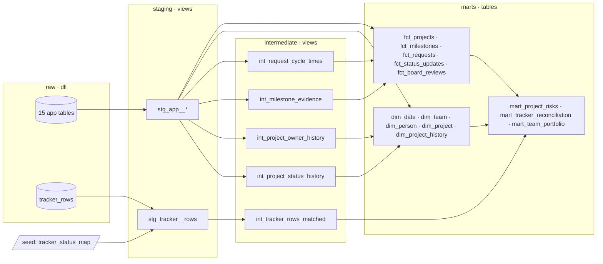

# Warehouse (stage 3)

`warehouse/` is a dbt project on DuckDB that turns the raw layer from stage 2 into a tested star schema and the tables the PMO actually works with: risk findings, a reconciliation of the old Excel tracker, and a per-team portfolio view.

```bash
uv run dbt build --project-dir warehouse --profiles-dir warehouse    # build + test everything
uv run dbt docs generate --project-dir warehouse --profiles-dir warehouse
uv run dbt docs serve --project-dir warehouse --profiles-dir warehouse   # lineage graph in the browser
```

35 models, 1 seed and 131 data tests. All of it rebuilds in a few seconds, and CI builds it twice: after a backfill, and again after an incremental load.

## Layers



| Layer | Schema | What happens there |
|---|---|---|
| staging | `staging` | One view per source table: renames, types, JSON payloads unpacked, derived flags. The tracker gets its three date formats parsed, old status labels mapped through a seed, and pasted duplicate rows flagged. |
| intermediate | `intermediate` | Building blocks that need more than one row: status and owner history rebuilt from the event log, evidence workflow per milestone, tracker rows matched to teams and projects, request cycle times, the as-of date. |
| marts | `marts` | The star schema and the PMO tables. Materialised as tables. |
| seeds | `reference` | `tracker_status_map`: the old tracker's status vocabulary and which system statuses each label can stand for. |

## Design decisions worth knowing

**History from the event log, not from snapshots.** Raw tables hold the latest version of each row (dlt merges on the primary key). `dim_project_history` is still a full SCD type 2 dimension, because it's rebuilt from `project_events`: a new version starts whenever status, owner or planned end changes. That gives complete history from day one, including the time before the warehouse existed, which snapshots can't. Three ASOF joins find the status, owner and end date in force at each change point.

**One evaluation date.** Everything that says "overdue", "days since update" or "past end" uses `int_as_of_date`: the `as_of_date` var if set, otherwise the last day in the data. Results are reproducible for any backfill, and you can replay the risk page for a past date:

```bash
uv run dbt build --project-dir warehouse --profiles-dir warehouse --vars '{as_of_date: "2026-03-31"}'
```

The replay is approximate: dates are evaluated as of that day, but milestone and evidence statuses are their current state. `dim_project_history` is the exact way to look at the past.

**Risk rules as SQL, thresholds as vars.** `mart_project_risks` reproduces the PMO platform's risk rules: overdue milestones, schedule gap, past end date, deadline close, owner left or no executor, repeated extensions, no recent update. Strategic projects are raised one level, and each project gets one main risk. The thresholds (`overdue_high_days`, `silence_mid_days`, …) live in `dbt_project.yml`, so changing a rule is a config change.

**Ambiguity kept, not guessed.** The old tracker's `Pending` meant either "not started" or "on hold". The seed maps it to both (`compatible_statuses`), and reconciliation accepts either rather than picking one.

**Messy inputs handled where they're visible.** Excel cuts sheet names at 31 characters (`HQ - Technical Support & Warran`), so sheets match teams by name prefix. Projects from before go-live appear under their legacy `TRK` code, so tracker rows match on either code. Mistyped references (`UKI-25-8` for `UKI-25-008`) are not silently fixed: they show up in reconciliation as `not_in_system` next to a `missing_in_tracker` row for the real project. That makes a good job for fuzzy matching or an LLM in stage 5.

## Marts

| Model | Grain | Highlights |
|---|---|---|
| `dim_project` | live project | team, office, region, owner (and whether they left), executors, dates, extensions |
| `dim_project_history` | project version | SCD2 on status / owner / planned end; `valid_from`, `valid_to`, `is_current` |
| `dim_team`, `dim_person`, `dim_date` | team / person / day | current managers, board roles, ISO weeks and which meeting falls on each Thursday |
| `fct_projects` | live project | milestones planned / accepted / overdue, delivery ratio, evidence returns, updates, days since update, change requests |
| `fct_milestones` | milestone | lateness against the original due date, overdue flag, submissions and returns |
| `fct_requests` | request version | kind, change types, outcome, PMO decision time in days |
| `fct_status_updates` | update | meeting it was for, whether it arrived before the meeting, author vs owner |
| `fct_board_reviews` | voting round | votes yes / no, days to outcome |
| `mart_project_risks` | risk finding | category, level, finding text, `is_main_risk` |
| `mart_tracker_reconciliation` | expected project or unmatched tracker row | `ok`, `status_mismatch`, `end_date_mismatch`, `missing_in_tracker`, `not_in_system` |
| `mart_team_portfolio` | team | in flight / active / on hold / awaiting close, recent closes and cancels, high-risk projects, overdue milestones, share of active projects updated in the last 30 days |

`analyses/portfolio_as_of_date.sql` shows a point-in-time query on the SCD2 history.

## Tests

- **Generic tests** on every model: unique and not-null keys, accepted values for every status-like column, relationships between staging tables and between marts and dimensions, a dependency-free `unique_combination` test (`tests/generic/`).
- **Singular tests** (`tests/`) for things that only hold if the logic is right:
  - the rebuilt status history ends in each project's current status;
  - SCD2 versions are contiguous, with exactly one current version per project, and the current version matches `dim_project`;
  - `fct_projects` covers every live project exactly once;
  - every flagged project has exactly one main risk;
  - every row of the latest tracker snapshot appears exactly once in the reconciliation.

dbt's anonymous usage tracking is switched off in `dbt_project.yml`.
